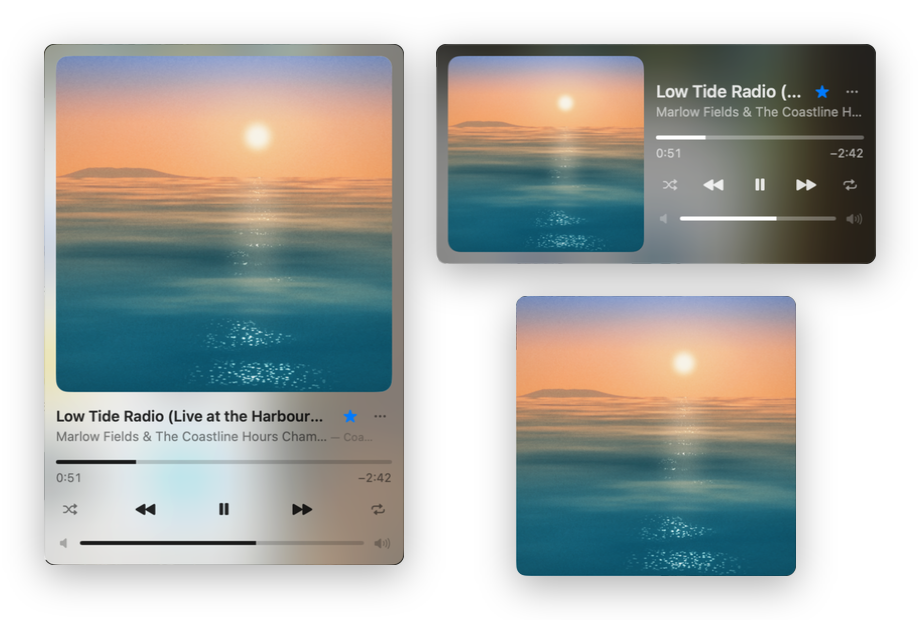
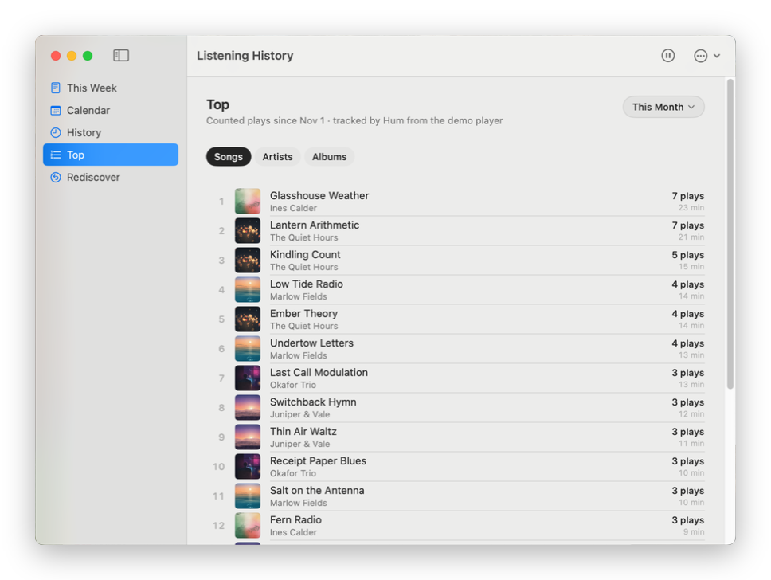

<p align="center">
  <picture>
    <source media="(prefers-color-scheme: dark)" srcset="design/logo/hum-lockup-horizontal-reversed.svg">
    
  </picture>
</p>

<h3 align="center">Your music, without the whole music app.</h3>

<p align="center">The song Music or Spotify is playing, as album art in a small floating player.</p>

<p align="center">
  macOS 15 or later · Apple silicon and Intel · Free<br>
  <a href="#install">Install</a> · <a href="docs/guide.md">Guide</a> · <a href="#line-apps">Line Apps</a>
</p>

<p align="center">
  
</p>

## What it does

- **Seven styles.** Art Only, Title, Text, Strip, Wide, Big Art, and Menu Bar:
  from the cover alone to a card with every control, or no window at all. Each
  keeps its own light and dark look.
- **Where you want it.** Pin the player to any of nine places on each display,
  or throw it and it settles in the nearest one.
- **Now, History, and Status.** Swipe between the song playing, a card or two
  about it and this session, and which app Hum follows. The Listening History
  window has the week, a calendar, top lists, and songs to rediscover.
- **Widgets and a lean menu.** Art Only, Title, and Text widgets on the desktop
  and in Notification Center, and a menu-bar menu with just the song, the
  controls, and Settings.

<p align="center">
  
</p>

## Install

```sh
brew install --cask millerroberts180/line-apps/hum
```

Or download the disk image from [Hum’s page](https://lineapps.vercel.app/hum/)
and drag Hum to Applications. On Apple silicon, the
[Line Apps](https://lineapps.vercel.app) installer puts in all four apps at
once.

Hum isn’t notarized yet, so macOS stops it the first time it opens. Choose
**Done**, then open System Settings › Privacy & Security and choose **Open
Anyway** beside Hum. The first time you use a control for Music or Spotify,
macOS asks whether Hum may control that app; choose **Allow**. The
[guide](docs/guide.md#install) has the rest.

## Private and native

- **No account.** Hum controls Music and Spotify only through their own apps,
  with Apple Events, and never plays audio itself. There’s nothing to sign in
  to.
- **History stays on your Mac.** What you play is kept in a file on this Mac
  and never sent anywhere. Hum goes online only to fetch the covers Spotify’s
  app links to.
- **Native.** Swift, SwiftUI, and AppKit, with no package dependencies: one
  universal app for Apple silicon and Intel, under 10 MB to download.

Hum has no separate privacy policy yet; these points are all it does with what
you play.

## Requirements

- macOS 15 or later, on Apple silicon or Intel. On macOS 26, Hum can use
  Liquid Glass.
- Music or Spotify, and the Automation permission for each one Hum controls.

## Build from source

```sh
scripts/build-app.sh    # universal release build, in build/Hum.app
open build/Hum.app
./scripts/test.sh       # every test
```

You need Swift 6.2; the Command Line Tools are enough. To try Hum without Music
or Spotify, run `build/Hum.app/Contents/MacOS/Hum --demo`. See
[docs/development.md](docs/development.md) for the rest.

## Documentation

- **[Guide](docs/guide.md):** installing, permissions, the styles and
  surfaces, the keyboard, and where Hum keeps things
- **[Development](docs/development.md):** building, testing, launch options,
  `hum://` URLs, releasing, and diagnostics
- **[Architecture](docs/ARCHITECTURE.md):** how the code is put together
- **[Design spec](docs/DESIGN.md):** how Hum looks, moves, and behaves, and
  the decisions behind it
- **[Logo](design/logo/README.md):** the mark, its masters, and how to use it

## Line Apps

Hum is one of four small Mac apps with one maker and one quiet design, each doing one job:

| App | What it does |
| --- | --- |
| **[Tuck](https://github.com/millerroberts180/tuck)** | Windows, files, links and notes, kept in your Mac’s notch |
| **[Pulse](https://github.com/millerroberts180/pulse)** | Feel web pages through your trackpad, and give typing a nicer sound |
| **[Hum](https://github.com/millerroberts180/hum)** | The song you’re playing, as album art in a small floating player |
| **[Glow](https://github.com/millerroberts180/glow)** | Brightness, volume and each monitor’s own settings, for every display |

[Line Apps](https://github.com/millerroberts180/line-apps) itself is a short line in the menu bar that
their icons collapse into, and one installer for all four. The
[Homebrew tap](https://github.com/millerroberts180/homebrew-line-apps) has each app’s cask.

## Licence

Hum is free to use, with every feature for everyone. © 2026 Miller Roberts. All
rights reserved.

Spotify is a trademark of Spotify AB. Apple Music is a trademark of Apple Inc.
Hum is not affiliated with or endorsed by either.
