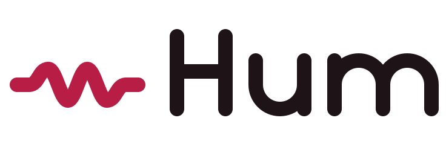

# Hum — Logo Guidelines

## 1. The logo

**Vibrato**: a flat line that breaks into two even ripples and settles, a
sustained hum. The ripples are round, not a zig-zag, and there are only two of
them, so it doesn’t read as an audio meter.

It’s built the way Pulse’s and Tuck’s marks are, on a 256-unit grid (unit 8).
The line runs at y 126 from x 28 to 228. Its crests sit at y 100 and its
troughs at y 152, with an extremum every 32 units from x 80 to 176. The stroke
is 24 with round caps and joins. Flat tangents at every crest and trough keep
the ripples soft. The mark sits 2 units above centre, the optical centre. The
masters are stroke-based, so scale the drawing and the stroke together.

| File | Use |
| --- | --- |
| `hum-app-icon.svg` | The macOS app icon: an 824-unit body (radius 186) on the 1024 grid in Hum Crimson, with the white symbol at 62 % |
| `hum-symbol-crimson.svg` / `-black.svg` / `-white.svg` | The symbol on its own, in brand colour, one-colour Ink, and reversed |
| `hum-symbol-small.svg` | For 32 px and below: shorter tails, taller ripples, stroke 32 |
| `hum-symbol-square.svg` | Centred on a square canvas, for avatars |
| `hum-wordmark.svg` | “Hum”, built from the symbol’s stroke |
| `hum-lockup-horizontal.svg` / `-reversed.svg` | Symbol and wordmark, for light and dark backgrounds |
| `png/` | Transparent PNGs of the above. The app icon PNGs come from the shipping icon set. |

`scripts/make-icon.swift` draws the same geometry and rebuilds
`Resources/AppIcon.icns`. It uses the small-size cut, at 75 %, for 32 px and
below. In the app’s interface, the menu bar keeps the system `waveform` glyph
that DESIGN.md specifies for `StatusMenu`.

## 2. Clear space

Leave clear space equal to the ripples’ height on every side of the symbol and
the lockup. That’s 52 units on the symbol’s grid, about a quarter of its width.

## 3. Minimum size

| Version | Screen |
| --- | --- |
| Horizontal lockup | 120 px wide |
| Symbol | 24 px wide; below 32 px use `hum-symbol-small.svg` |
| App icon | 16 px (the icon set includes the small-size cut) |

## 4. Colour

Use one colour and white. Don’t use gradients or shadows on the mark itself.
The app icon’s soft body shadow is the macOS icon convention.

| Name | HEX | RGB | Use |
| --- | --- | --- | --- |
| Hum Crimson | `#B81D45` | 184 29 69 | App icon body, the symbol in colour |
| Ink | `#1E1418` | 30 20 24 | One-colour symbol, the wordmark on light backgrounds |
| White | `#FFFFFF` | 255 255 255 | The symbol on Hum Crimson, the wordmark on dark backgrounds |

White on Hum Crimson has a contrast ratio of 6.4:1, which passes WCAG AA. Ink on
white is 18:1. Crimson on Ink is only 2.8:1. Where a mark on a dark background
has to pass 3:1, use the white symbol.

For print, CMYK is about 0 84 63 28. That’s a plain conversion, not a print
profile, so proof it. The nearest Pantones are about 7636 C and 193 C; check a
physical swatch.

## 5. Typography

The wordmark is drawn, not typeset, so no font licence is involved. It’s
monoline from the symbol’s 24-unit stroke, with round terminals. The cap height
runs from y 60 to 180 and the x-height from y 100 to 180, so the ripples fill
the x-height the way Pulse’s bump does. Alongside it in the interface, use the
system font (SF Pro). The name is always “Hum”, with a capital H.

## 6. Don’ts

- Don’t add a third ripple or make the two uneven. Two even ripples are the
  idea.
- Don’t sharpen the ripples into a zig-zag or turn them into a level meter.
- Don’t recolour the mark beyond Hum Crimson, Ink, and White, or add gradients.
- Don’t stretch it, change the stroke weight on its own, or outline it.
- Don’t set the wordmark in another typeface.
- Don’t place the crimson symbol on busy images or mid-tone backgrounds; use the
  white or Ink version.

## 7. Notes

This is Pulse’s and Tuck’s sibling: the same grid, the same 24-unit line, round
ends, and a flat body. It went through concepts, an audit, and a small-size
test. No trademark search has been done, so run one before relying on the mark
publicly.
